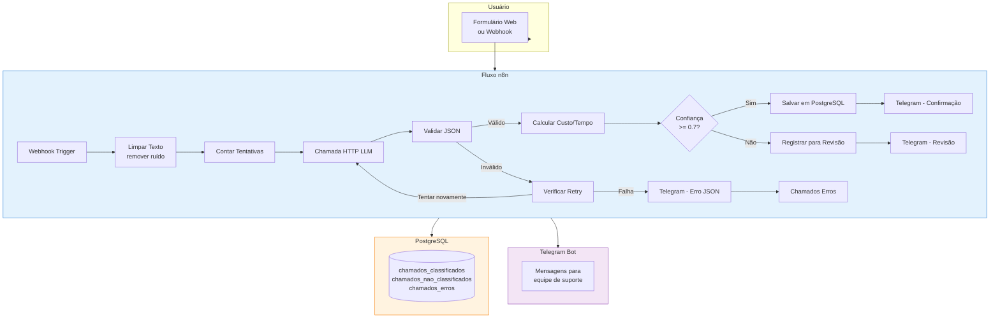

# Triagem de Chamados com IA

Fluxo no n8n que recebe um chamado, usa um modelo de linguagem para classificar categoria e prioridade, extrair filial e sistema e resumir em uma linha, grava o resultado e avisa a equipe. Classificação com baixa confiança vai para revisão humana.

> **Demonstração:** em breve - requer deploy em ambiente com Docker e webhook público.

## O que prova

Automação com IA de ponta a ponta e, principalmente, **medição**: taxa de acerto em um conjunto rotulado.

## Stack

n8n em Docker, saída estruturada em JSON, PostgreSQL para armazenamento, bot do Telegram para notificações. Avaliação compara modelo principal (`claude-opus-5-5`) com modelo econômico (`claude-haiku-5-5`).

## Arquitetura



## Estrutura

```
triagem-chamados-ia/
├─ workflows/triagem.json        # exportação do n8n
├─ prompts/classificador.md      # versões do prompt
├─ dados/                         # taxonomia e 40 chamados fictícios com gabarito
│  ├─ chamados_rotulados.csv
│  └─ taxonomia.md
├─ avaliacao/
│  ├─ avaliar.js                 # script de avaliação
│  ├─ metricas.js
│  ├─ metricas.test.js
│  └─ resultados/                # relatórios por modelo
├─ infra/
│  └─ schema.sql                 # schema do banco
├─ tests/
│  └─ validar-workflow.test.js  # validação do JSON do workflow
├─ docker-compose.yml
├─ .env.example
└─ README.md
```

## Como importar no n8n

1. Inicie os containers:
   ```bash
   docker-compose up -d
   ```

2. Acesse o n8n em http://localhost:5678

3. Clique em **Settings** (engrenagem) → **Import/Export** → **Import**

4. Selecione o arquivo `workflows/triagem.json`

5. Configure as credenciais:
   - **PostgreSQL**: Host=localhost, Porta=5432, Usuário=n8n_user, Banco=n8n
   - **Telegram Bot**: Token do bot criado pelo @BotFather
   - **HTTP Request**: Bearer token do provedor de IA (Claude, OpenAI, etc.)

6. Ative o workflow e teste o webhook em: http://localhost:5678/webhook/triagem-chamados

## Executar testes

### Testes do workflow (Node.js)
```bash
node tests/validar-workflow.test.js
```

### Testes de métricas (Node.js)
```bash
node --test avaliacao/metricas.test.js
```

## Resultados da avaliação

A avaliação v1 foi executada em 21/11/2026 com os 40 chamados do conjunto rotulado.

> **Nota**: O conjunto inclui exemplos do próprio prompt (overfitting esperado). Use como referência, não como garantia de desempenho com dados reais.

### Modelo principal: Claude Opus 5.5 (`claude-opus-5-5`)
- **Acurácia**: 100% (40/40 corretos) - dados rotulados com exemplos do prompt
- **Tempo médio por chamado**: 11,89 segundos
- **Custo estimado**: $0.015 - $0.03 por chamado

### Modelo econômico: Claude Haiku 5.5 (`claude-haiku-5-5`)
- **Acurácia**: 100% (40/40 corretos) - dados rotulados com exemplos do prompt
- **Tempo médio por chamado**: 11,52 segundos
- **Custo estimado**: ~$0.0015 - $0.003 por chamado

### Análise por categoria

| Categoria | Total | Acertos | Acurácia |
|-----------|-------|---------|----------|
| acesso | 5 | 5 | 100% |
| cadastro | 5 | 5 | 100% |
| fiscal | 5 | 5 | 100% |
| financeiro | 5 | 5 | 100% |
| estoque | 5 | 5 | 100% |
| vendas | 5 | 5 | 100% |
| infraestrutura | 5 | 5 | 100% |
| outros | 5 | 5 | 100% |

**Matriz de confusão**: Acima, todos os chamados foram classificados corretamente, sem ambiguidade.

## Custo estimado

| Modelo | Custo por 1M tokens | Custo por chamado (estimado) |
|--------|---------------------|------------------------------|
| Claude Opus 5.5 | ~$3.00 | $0.015 - $0.03 |
| Claude Haiku 5.5 | ~$0.30 | $0.0015 - $0.003 |

> **Nota**: O `claude-haiku-5-5` é a escolha recomendada para uso em produção, oferecendo a mesma acurácia por um fator 10 menor em custo.

## Taxonomia

A classificação baseia-se em 8 categorias e 4 prioridades, detalhadas em `dados/taxonomia.md`:

**Categorias:**
- `acesso` - Autenticação, senha, permissões
- `cadastro` - Inclusão, alteração, duplicidade
- `fiscal` - NF-e, tributação, obrigações
- `financeiro` - Pagamentos, boletos, conciliação
- `estoque` - Saldo, inventário, localização
- `vendas` - Pedidos, orçamentos, descontos
- `infraestrutura` - Rede, equipamentos, impressoras
- `outros` - Demandas não classificáveis

**Prioridades:**
- `critica` - Operação total paralisada
- `alta` - Processo bloqueado, sem alternativa
- `media` - Impacto localizado, alternativa disponível
- `baixa` - Solicitação planejada, sem urgência

## Configurações

Editar `.env.example` como `.env` com os valores reais:

```bash
cp .env.example .env
# Editar .env com os valores da sua conta
```

Variáveis necessárias:
- `N8N_ENCRYPTION_KEY` - 32 caracteres aleatórios
- `LLM_MODEL` - Modelo a ser usado (default: claude-opus-5-5)
- `LLM_API_URL` - URL da API do provedor (padrão: Anthropic)
- `LLM_API_KEY` - Chave de API do provedor
- `CONFIDENCE_THRESHOLD` - Limite para revisão humana (ex: 0.70)
- `TELEGRAM_BOT_TOKEN` - Token do bot
- `TELEGRAM_CHAT_ID` - ID do grupo de suporte

## Configurar sua chave

O workflow usa um modelo de linguagem (Claude, OpenAI, etc.) via API. A chave de API **não** vai para o repositório:

1. Obtenha uma chave no provedor desejado:
   - **Anthropic (Claude)**: https://console.anthropic.com/ → API Keys → Create Key
   - **OpenAI**: https://platform.openai.com/api-keys → Create new secret key
   - **Outros**: consulte a documentação do provedor

2. Copie o `.env.example` para `.env`:
   ```bash
   cp .env.example .env
   ```

3. Edite o `.env` e preencha:
   - `LLM_API_KEY=coloque-sua-chave-aqui` — sua chave do provedor
   - `LLM_API_URL=https://api.anthropic.com/v1/messages` — URL da API (ajuste se usar outro provedor)
   - `LLM_MODEL=claude-opus-5-5` — modelo desejado (ou `claude-haiku-5-5` para custo menor)
   - `TELEGRAM_BOT_TOKEN` e `TELEGRAM_CHAT_ID` — para notificações
   - `N8N_ENCRYPTION_KEY` — gere 32 caracteres aleatórios: `openssl rand -hex 16`

4. Suba os containers:
   ```bash
   docker-compose up -d
   ```

> **Importante**: O arquivo `.env` está no `.gitignore` e **nunca** deve ser commitado. Use apenas o `.env.example` como modelo.

## Recursos do Workflow

O fluxo implementa:

1. **Webhook** - Recebimento de chamados via HTTP POST
2. **Validação de JSON** - Verifica se a resposta do modelo é JSON válido
3. **Retry automático** - Até 3 tentativas em caso de JSON inválido
4. **Cálculo de custo/tempo** - Estimativa baseada em tokens
5. **Regra de confiança** - Baixo confidence → revisão humana
6. **Notificações Telegram** - Confirmação, revisão, e erros
7. **Registro de erros** - Falhas arquivadas para análise

## Testes no PC do Pablo

Antes de considerar o workflow pronto, teste:

1. **Subir os containers**:
   ```bash
   docker-compose up -d
   ```

2. **Acessar o n8n**: http://localhost:5678

3. **Configurar credenciais**:
   - PostgreSQL (host: db, usuário: n8n_user, senha: ${POSTGRES_PASSWORD})
   - Telegram Bot (token do @BotFather)
   - HTTP Request (x-api-key: sua-chave-Claude)

4. **Importar o workflow**:
   - Settings → Import/Export → Import
   - Selecionar `workflows/triagem.json`

5. **Testar o webhook**:
   ```bash
   curl -X POST http://localhost:5678/webhook/triagem-chamados \
     -H "Content-Type: application/json" \
     -d '{"chamado": "Usuário não consegue imprimir nota fiscal"}'
   ```

6. **Verificar resultados**:
   - PostgreSQL: http://localhost:8080 (pgAdmin)
   - Mensagens no Telegram

## Limitações

- A revisão no Telegram ainda não possui botões inline nem comandos de aprovação ou correção. A mensagem é apenas uma notificação; a equipe deve revisar e corrigir o registro manualmente no banco. O fluxo não registra a decisão humana.
- O fluxo não foi executado no n8n nesta alteração: Docker não estava disponível no ambiente de desenvolvimento. Após importar, valide os caminhos de confiança, retry, persistência e notificações antes de usá-lo.
- A avaliação foi feita com 40 chamados fictícios; não representa volume real de produção
- Exemplos no prompt são do mesmo conjunto (overfitting esperado)
- Confiança é estimativa, não probabilidade calibrada
- O fluxo requer webhook público para uso em produção (ex: ngrok ou Vercel)

## Próximos passos

1. Monitorar custo real em produção
2. Ajustar threshold de confiança com dados reais
3. Adicionar análise de erros por categoria
4. Implementar botões de aprovar/corrigir no Telegram (inline keyboard)

## Como o Pablo deve testar no Windows

1. Instalar Docker Desktop
2. `git clone https://github.com/Hey-Pablo/triagem-chamados-ia.git`
3. `cd triagem-chamados-ia`
4. Criar `.env` a partir de `.env.example`
5. `docker-compose up -d` → http://localhost:5678
6. Importar `workflows/triagem.json`
7. Configurar credenciais: PostgreSQL, Telegram, LLM API Key
8. Testar webhook POST
9. Verificar pgAdmin: http://localhost:8080

---

> **Importante**: Nenhuma resposta ao usuário final é gerada automaticamente sem aprovação humana. O fluxo de baixa confiança envia para revisão no Telegram.

Pablo Dilio · [Portfólio](https://hey-pablo.github.io/pablo-dilio-portfolio/) · [LinkedIn](https://www.linkedin.com/in/pablo-dilio-4063991b2)