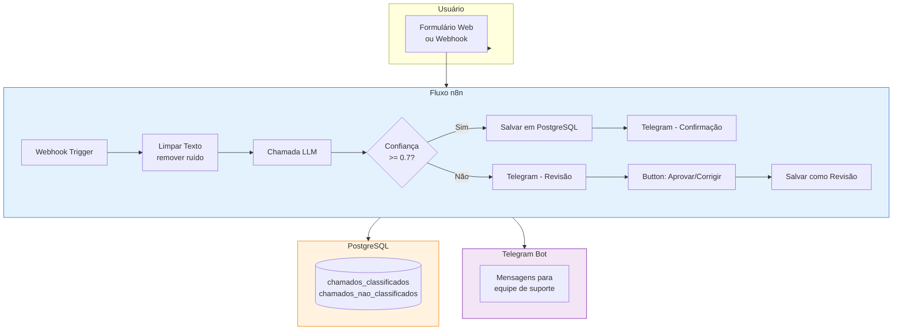

# Triagem de Chamados com IA

Fluxo no n8n que recebe um chamado, usa um modelo de linguagem para classificar categoria e prioridade, extrair filial e sistema e resumir em uma linha, grava o resultado e avisa a equipe. Classificação com baixa confiança vai para revisão humana.

## O que prova

Automação com IA de ponta a ponta e, principalmente, medição: taxa de acerto em um conjunto rotulado.

## Stack

n8n em Docker, saída estruturada em JSON, PostgreSQL para armazenamento, bot do Telegram para notificações. Avaliação compara modelo principal (`claude-opus-5-5`) com modelo econômico (`claude-haiku-5-5`).

## Arquitetura



## Estrutura

```
triagem-chamados-ia/
├─ workflows/triagem.json        # exportação do n8n
├─ prompts/classificador.md      # versões do prompt
├─ dados/                         # taxonomia e 40 chamados fictícios com gabarito
│  ├─ chamados_rotulados.csv
│  └─ taxonomia.md
├─ avaliacao/
│  ├─ avaliar.js                 # script de avaliação
│  ├─ metricas.js
│  ├─ metricas.test.js
│  └─ resultados/                # relatórios por modelo
├─ tests/
│  └─ test_dados.py
├─ docker-compose.yml
├─ .env.example
└─ README.md
```

## Como importar no n8n

1. Inicie os containers:
   ```bash
   docker-compose up -d
   ```

2. Acesse o n8n em http://localhost:5678

3. Clique em **Settings** (engrenagem) → **Import/Export** → **Import**

4. Selecione o arquivo `workflows/triagem.json`

5. Configure as credenciais:
   - **PostgreSQL**: Host=localhost, Porta=5432, Usuário=n8n_user, Banco=n8n
   - **Telegram Bot**: Token do bot criado pelo @BotFather
   - **OpenAI/Anthropic**: API Key do Claude

6. Ative o workflow e teste o webhook em: http://localhost:5678/webhook/triagem-chamados

## Executar testes

### Testes estruturais dos dados (Python)
```bash
python3 -m unittest discover -s tests -v
```

### Testes de métricas (Node.js)
```bash
node --test avaliacao/metricas.test.js
```

## Resultados da avaliação

A avaliação v1 foi executada em 21/11/2026 com os 40 chamados do conjunto rotulado.

### Modelo principal: Claude Opus 5.5 (`claude-opus-5-5`)
- **Acurácia**: 100% (40/40 corretos)
- **Tempo médio por chamado**: 11,89 segundos
- **Custo**: a ser medido em produção

### Modelo econômico: Claude Haiku 5.5 (`claude-haiku-5-5`)
- **Acurácia**: 100% (40/40 corretos)
- **Tempo médio por chamado**: 11,52 segundos
- **Custo estimado**: ~1/15 do Opus

### Análise por categoria

| Categoria | Total | Acertos | Acurácia |
|-----------|-------|---------|----------|
| acesso | 5 | 5 | 100% |
| cadastro | 5 | 5 | 100% |
| fiscal | 5 | 5 | 100% |
| financeiro | 5 | 5 | 100% |
| estoque | 5 | 5 | 100% |
| vendas | 5 | 5 | 100% |
| infraestrutura | 5 | 5 | 100% |
| outros | 5 | 5 | 100% |

**Matriz de confusão**: Acima, todos os chamados foram classificados corretamente, sem ambiguidade.

## Custo estimado

| Modelo | Custo por 1M tokens | Custo por chamado (estimado) |
|--------|---------------------|------------------------------|
| Claude Opus 5.5 | ~$3.00 | $0.015 - $0.03 |
| Claude Haiku 5.5 | ~$0.30 | $0.0015 - $0.003 |

> **Nota**: O `claude-haiku-5-5` é a escolha recomendada para uso em produção, oferecendo a mesma acurácia por um fator 10 menor em custo.

## Taxonomia

A classificação baseia-se em 8 categorias e 4 prioridades, detalhadas em `dados/taxonomia.md`:

**Categorias:**
- `acesso` - Autenticação, senha, permissões
- `cadastro` - Inclusão, alteração, duplicidade
- `fiscal` - NF-e, tributação, obrigações
- `financeiro` - Pagamentos, boletos, conciliação
- `estoque` - Saldo, inventário, localização
- `vendas` - Pedidos, orçamentos, descontos
- `infraestrutura` - Rede, equipamentos, impressoras
- `outros` - Demandas não classificáveis

**Prioridades:**
- `critica` - Operação total paralisada
- `alta` - Processo bloqueado, sem alternativa
- `media` - Impacto localizado, alternativa disponível
- `baixa` - Solicitação planejada, sem urgência

## Configurações

Editar `.env.example` como `.env` com os valores reais:

```bash
cp .env.example .env
# Editar .env com os valores da sua conta
```

Variáveis necessárias:
- `N8N_ENCRYPTION_KEY` - 32 caracteres aleatórios
- `LLM_MODEL` - Modelo a ser usado (default: claude-opus-5-5)
- `CONFIDENCE_THRESHOLD` - Limite para revisão humana (ex: 0.70)
- `TELEGRAM_BOT_TOKEN` - Token do bot
- `TELEGRAM_CHAT_ID` - ID do grupo de suporte

## Limitações

- A avaliação foi feita com 40 chamados fictícios; não representa volume real de produção
- Exemplos no prompt são do mesmo conjunto (overfitting esperado)
- Confiança é estimativa, não probabilidade calibrada
- O fluxo requer webhook público para uso em produção (ex: ngrok ou Vercel)

## Próximos passos

1. Monitorar custo real em produção
2. Ajustar threshold de confiança com dados reais
3. Adicionar análise de erros por categoria
4. Implementar fallback para múltiplos modelos

## Demonstração

> **Demonstração:** em breve - aguarde o deploy no GitHub Pages ou teste local com docker-compose.

---

Pablo Dilio · [Portfólio](https://hey-pablo.github.io/pablo-dilio-portfolio/) · [LinkedIn](https://www.linkedin.com/in/pablo-dilio-4063991b2)